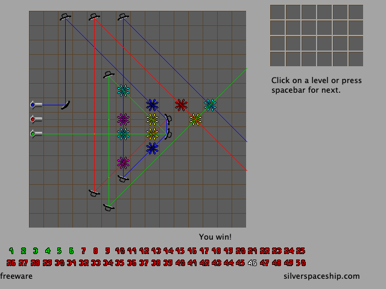
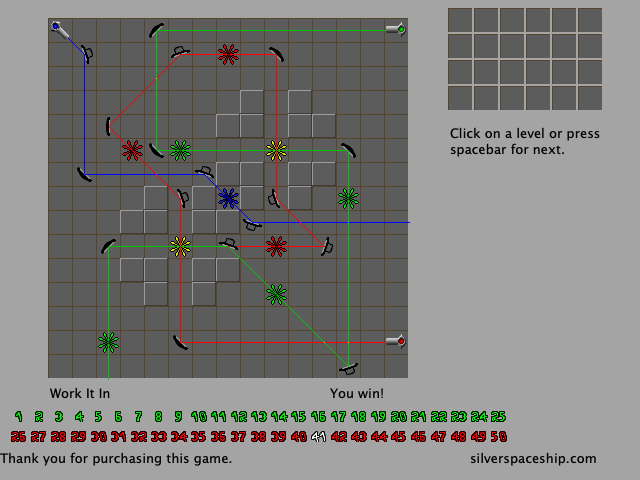
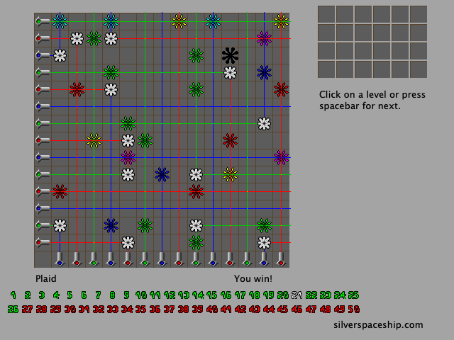

# 🔴🟢🔵 Chromatron for modern macOS

Native Apple Silicon versions of Sean Barrett's laser puzzle games **Chromatron**, **Chromatron 2**, **Chromatron 3** and **Chromatron 4** (Silver Spaceship Software, 2003–2004). 🔦✨

The original Mac versions are PowerPC Carbon apps, which no longer run on current macOS. This project rebuilds them in Rust 🦀 as four separate apps that look and play like the originals: same rules, levels, sprites and text. The same engine also runs in the browser.

<table>
  <tr>
    <td align="center"><br><b>Chromatron</b></td>
    <td align="center"><br><b>Chromatron 2</b></td>
  </tr>
  <tr>
    <td align="center"><br><b>Chromatron 3</b></td>
    <td align="center"><br><b>Chromatron 4</b></td>
  </tr>
</table>

> [!NOTE]
> 📦 This repository contains **no game data**. The build reads the levels, graphics and text from the original apps, which you download from the author's site (see below), and embeds them in the new apps on your machine. The screenshots above are of this port.

## 🌐 Play in your browser

**[shengtuo.me/chromatron-remake](https://shengtuo.me/chromatron-remake/)** plays all four games in one page, in current Safari, Chrome and Firefox. Progress stays in your browser, and solutions copied on the page paste into the Mac apps and back. To build the page yourself, install the matching `wasm-bindgen` CLI (`just web` prints the exact `cargo install` command), then run `just web-serve` and open <http://127.0.0.1:8000/>.

## 🧰 Requirements

- 🍎 macOS 11 or later on Apple Silicon
- 🍺 [Homebrew](https://brew.sh)
- 🦀 Rust, installed with [rustup](https://rustup.rs) (not Homebrew)
- 🛠️ Xcode Command Line Tools (`xcode-select --install`)

## 🚀 Build

```sh
brew install just
just init      # install the Homebrew dependencies and download the original games
just bundle    # build the four apps into dist/
```

`just init` downloads `chromatron_mac.zip` from [silverspaceship.com/chromatron](https://silverspaceship.com/chromatron/), checks its SHA-256, and unpacks the four original apps into `chromatron_mac/`. If you already have them elsewhere, set `CHROMATRON_ORIGINALS` to that folder instead.

`just bundle` produces `Chromatron.app`, `Chromatron 2.app`, `Chromatron 3.app` and `Chromatron 4.app` in `dist/`. Drag them into `/Applications`, or run one straight from source with `just run 1` (up to `4`).

## 🎮 Playing

Guide the coloured beams 🌈 to light every target. Drag pieces between the toolbox and the board. Click a piece to turn it 45° anticlockwise; right-click (or Shift-, Option- or Control-click) to turn it clockwise. Pick a level from the numbered level strip; solving levels unlocks more. 🔓

| | Command | Shortcut |
|---|---|---|
| 🔄 | Reset Level | ⌘R |
| ⏭️ | Next Level / Previous Level | ⌘= / ⌘- |
| 📋 | Copy Level (your solution, as text) | ⌘C |
| 📥 | Paste Level (a copied solution) | ⌘V |
| 🖥️ | Full screen | ⌃⌘F |

- 🖱️ **File ▸ Mouse Wheel Changes Level** turns level switching with the scroll wheel on or off.
- 🔍 **View ▸ Scale** sets the window size in whole multiples of the original 640×480, so pixels stay sharp.
- 💾 Progress is saved in `~/Library/Application Support/Chromatron N/` in the original games' own file format. Each game reopens on the level you last played.

## 🧑‍💻 Development

See [CLAUDE.md](CLAUDE.md) for the architecture and the full list of `just` recipes. In short: `just test` runs the tests, `just lint` checks formatting and lints, `just bench` checks the engine against its performance budgets, `just screenshots` regenerates the images above, and `just web-check` builds the browser version and plays every stored solution through it in Node.

## 🙏 Credits

Chromatron's game design, levels, graphics and text are by Sean Barrett / Silver Spaceship Software. This is an independent port, not affiliated with or endorsed by the author.
